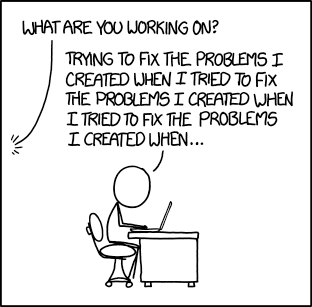
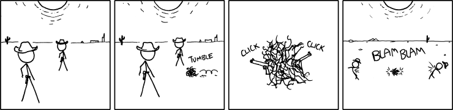

<h1 align="center">⭐ class Deep(Github):</h1>

<p align="center">
  <a href="#tech-stack"></a>
  <a href="#tech-stack"></a>
  <a href="#tech-stack"></a>
  <a href="#tech-stack"></a>
  <a href="#tech-stack"></a>
  <a href="#tech-stack"></a>
  <a href="#tech-stack"></a>
  <a href="#tech-stack"></a>
  <a href="#tech-stack"></a>
</p>

<p align="center"><strong>
  <a href="#projects">Projects</a> ·
  <a href="https://pradeeptathineni.github.io/labs/">Labs</a> ·
  <a href="https://github.com/pradeeptathineni?tab=stars">GitHub Stars</a> ·
  <a href="https://github.com/neon1llc">neon1</a> ·
  <a href="https://www.linkedin.com/in/pradeep-tathineni/">LinkedIn</a>
</strong></p>

<div align="center">

```python
self.AUTHOR = "Pradeep Tathineni" if env.PROPER else "Deep"

self.SECTIONS = [ self.identity, self.values, self.projects, self.tech_stack, self.neon1, Meta ]

# Could you imagine if we chose to center our code?
```

</div>
<br/>

## 🪪 def identity(self, title="Hello World!"):

<details open>
<summary>self.identity.group(<strong>"<ins>Core</ins>"</strong>)</summary>

<p></p>

> `self.WHO` = "I'm an engineer who sees repeated work as a design problem: if I have to do it twice, I start asking why the computer isn't doing it."

```python
# Once is flirtation. Twice is frustration.
# Once is temptation. Twice is libation.
# Once is foundation. Twice is causation.
#
# All thereafter is automation.
```

> `self.WHAT` = "I have 8+ years of professional experience in automation, application development, cloud, DevOps, and security, and nearly two decades of exploring technology."

> `self.WHY` = "My constant pursuit has always been to enable people with technology solutions that make their work and lives easier."

</details>

<p></p>

<details>
<summary>self.identity.group(<strong>"<ins>More</ins>"</strong>)</summary>

<p></p>

```python
self.FOCUSES["domains"] = [
    "Automation", # performance
    "Cloud",      # enablement
    "DevOps",     # delivery
    "Security",   # confidence
    "AI",         # automation 2.0
]

self.FOCUSES["concepts"] = [
    "Open Source",
    "Prior Art",
    "Developer Tools",
    "Evidence-Based Decisions",
]

self.FOCUSES["exploring"] = [
    "Simulation",
    "Computer Vision",
    "EdTech",
    "EnviroTech",
    "AgriTech",
    "GeoTech",
]

self.INTERESTS = [
    "Dog", # TODO Add link to dog pic
    "Education",
    "Community",
    "Gardening",
    "Biking",
    "Hiking",
    "Tacos",
    "Driving Fast",
]
```

</details>

<br/>

## 🧭 def values(self, group="technology"):

<details open>
<summary>self.values.group(<strong>"<ins>Intentions</ins>"</strong>)</summary>

<p></p>

> `#` **Learn and share** — Knowing my options is paramount to good decisions. Sharing what I learn helps others make theirs.\
> `#` **Strengthen my AI engineering practice** — Improve how I give AI context, coordinate its work, and verify its results.\
> `#` **Create deterministic tools** — Automate repeated work so I can trace what happened and verify the result.\
> `#` **Build on existing OSS** — Reuse, adapt, and integrate open-source software before writing custom code.\
> `#` **Build useful public OSS** — Start with a need I have. Expand when other people's use cases reveal a shared problem.

</details>

<p></p>

<details>
<summary>self.values.group(<strong>"<ins>Practices</ins>"</strong>)</summary>

<p></p>

> `#` **Research deeply before building** — Compare existing tools and approaches. My [GitHub Stars](https://github.com/pradeeptathineni?tab=stars) collect possibilities to investigate.\
> `#` **Back claims with evidence** — Cite sources, measure results, and compare them with a baseline.\
> `#` **Generalize across real use cases** — Check whether an idea holds across different needs. Keep the shared pattern and the differences that matter.\
> `#` **Remove, automate, verify, and revisit** — Keep changes small, check that they help, and keep a way to recover.

</details>

<br/>

## <a name="projects"></a>🚀 def projects(self, type="personal"):

<details>
<summary>self.projects.info()</summary>

<p></p>

- Project Name/Link — Short project description.
  | | |
  | :----------- | :---------------------------------------------------------------------------------------------------------------------------------------------- |
  | **Flow** | The intended path from input → outcome. |
  | **Maturity** | · `Idea` for proposed work, `Experimental` for unreleased work, or a release version.<br/>· A release is a checkpoint. Pre-`v1.0.0` releases generally remain experimental. |
  | **Status** | What exists and works today. |
  | **Activity** | · Updated: last default-branch commit date.<br/>· `Recent` means within 90 days of the check date, otherwise `Quiet`.<br/>· Proposed projects show planning status instead. |
  | **Tags** | Technologies and areas of focus. |

> `#` Public release and activity facts last checked on 2026-10-12.

</details>

<p></p>

<!-- Refresh public release/activity facts: python3 .meta/scripts/project_metadata.py -->

<details>
<summary>self.projects.group(<strong>"<ins>Cloud and DevOps Engineering</ins>"</strong>)</summary>

<p></p>

<dl><dd>

<details>
<summary><a href="https://github.com/pradeeptathineni/eng-challenge-aws-terraform"><strong>AWS Terraform Engineering Challenge</strong></a> — Make AWS web infrastructure reproducible and inspectable.</summary>

|              |                                                                                                   |
| :----------- | :------------------------------------------------------------------------------------------------ |
| **Flow**     | _requirements → Terraform plan → deploy → verify → tear down_                                     |
| **Maturity** | `Experimental`                                                                                    |
| **Status**   | Modular infrastructure, CI, and deployment checks exist. This is still a challenge-scale project. |
| **Activity** | Updated 2026-09-12 · `Recent`                                                                     |
| **Tags**     | `aws` ; `terraform` ; `devops`                                                                    |

</details>

</dd></dl>

</details>

<p></p>

<details>
<summary>self.projects.group(<strong>"<ins>Automation and Tooling</ins>"</strong>)</summary>

<p></p>

<dl><dd>

<details>
<summary><a href="https://github.com/neon1llc/aws-clip"><strong>AWS CLI Plus</strong></a> — Make multi-profile AWS CLI work easier to follow and safer.</summary>

|              |                                                                                            |
| :----------- | :----------------------------------------------------------------------------------------- |
| **Flow**     | _select profile → verify identity → check policy → run AWS CLI_                            |
| **Maturity** | `Experimental`                                                                             |
| **Status**   | Working Go wrapper around AWS CLI v2. Account checks and guarded commands are implemented. |
| **Activity** | Updated 2026-09-13 · `Recent`                                                              |
| **Tags**     | `aws` ; `cli` ; `go` ; `automation`                                                        |

</details>

<details>
<summary><a href="https://github.com/pradeeptathineni/shoulda-used-that"><strong>ShouldaUsedThat</strong></a> — Find what to reuse, what to skip, and what remains worth building.</summary>

|              |                                                                                                                                                                      |
| :----------- | :------------------------------------------------------------------------------------------------------------------------------------------------------------------- |
| **Flow**     | _problem → candidates → evidence → decision → revisit_                                                                                                               |
| **Maturity** | [`v0.4.0`](https://github.com/pradeeptathineni/shoulda-used-that/releases/tag/v0.4.0)                                                                                |
| **Status**   | Deterministic CLI and [reviewed catalog](https://pradeeptathineni.github.io/shoulda-used-that/curation/) exist. Each reuse decision still needs contextual judgment. |
| **Activity** | Updated 2026-09-20 · `Recent`                                                                                                                                        |
| **Tags**     | `oss` ; `prior-art` ; `python`                                                                                                                                       |

</details>

</dd></dl>

</details>

<p></p>

<details>
<summary>self.projects.group(<strong>"<ins>AI Systems</ins>"</strong>)</summary>

<p></p>

> `#` These projects explore my AI engineering direction, from planning and evidence to development and orchestration.

<dl><dd>

<details>
<summary><strong>Planning AI</strong> — Keep project intent, research, decisions, and next steps coherent.</summary>

|              |                                                                  |
| :----------- | :--------------------------------------------------------------- |
| **Flow**     | _question → research → explore → decide → prepare work_          |
| **Maturity** | `Experimental` · Private                                         |
| **Status**   | A working private planning workspace. No standalone application. |
| **Activity** | Updated 2026-10-11 · `Recent`                                    |
| **Tags**     | `planning` ; `research` ; `knowledge`                            |

</details>

<details>
<summary><a href="https://github.com/pradeeptathineni/signals-ai"><strong>Signals AI</strong></a> — Find and retain evidence that helps me choose worthwhile project work.</summary>

|              |                                                                                                                                                       |
| :----------- | :---------------------------------------------------------------------------------------------------------------------------------------------------- |
| **Flow**     | _question → research → assess → compare → retain → revisit_                                                                                           |
| **Maturity** | [`v0.3.0`](https://github.com/pradeeptathineni/signals-ai/releases/tag/v0.3.0) · Preview                                                              |
| **Status**   | Research workspace and [public Corpus](https://pradeeptathineni.github.io/signals-ai/) exist. This is still well short of the discovery value I want. |
| **Activity** | Updated 2026-10-11 · `Recent`                                                                                                                         |
| **Tags**     | `ai` ; `evidence` ; `discovery` ; `typescript`                                                                                                        |

</details>

<details>
<summary><a href="https://github.com/pradeeptathineni/context-ai"><strong>Context AI</strong></a> — Equip AI-assisted projects with reusable engineering guidance.</summary>

|              |                                                                                                        |
| :----------- | :----------------------------------------------------------------------------------------------------- |
| **Flow**     | _need → select guidance → plan adoption → apply → verify → refine_                                     |
| **Maturity** | [`v0.3.0`](https://github.com/pradeeptathineni/context-ai/releases/tag/v0.3.0) · Preview               |
| **Status**   | Guidance selection, installation, and undo work. Broader everyday usefulness remains under evaluation. |
| **Activity** | Updated 2026-10-10 · `Recent`                                                                          |
| **Tags**     | `ai` ; `context-engineering` ; `devtools`                                                              |

</details>

<details>
<summary><a href="https://github.com/pradeeptathineni/principles-ai"><strong>Principles AI</strong></a> — Make evidence-informed domain principles simple to research, understand, and apply.</summary>

|              |                                                                                                 |
| :----------- | :---------------------------------------------------------------------------------------------- |
| **Flow**     | _research → reconcile → define → apply → reassess_                                              |
| **Maturity** | `Experimental`                                                                                  |
| **Status**   | Structured corpus and validation tooling exist. The guidance remains under research and review. |
| **Activity** | Updated 2026-09-10 · `Recent`                                                                   |
| **Tags**     | `ai` ; `principles` ; `learning` ; `evidence`                                                   |

</details>

<details>
<summary><a href="https://github.com/pradeeptathineni/blueprint-ai"><strong>Blueprint AI</strong></a> — Create and evolve software projects with practical engineering checks.</summary>

|              |                                                                                                                |
| :----------- | :------------------------------------------------------------------------------------------------------------- |
| **Flow**     | _inspect → plan → create or evolve → review → verify_                                                          |
| **Maturity** | [`0.9.0`](https://github.com/pradeeptathineni/blueprint-ai/releases/tag/0.9.0)                                 |
| **Status**   | Working CLI for project creation, inspection, review, and evolution. Optional model reasoning remains bounded. |
| **Activity** | Updated 2026-10-03 · `Recent`                                                                                  |
| **Tags**     | `devtools` ; `python` ; `engineering`                                                                          |

</details>

<details>
<summary><strong>Intentional AI</strong> — Schedule autonomous project development within deliberate timing and scope.</summary>

|              |                                                                                                    |
| :----------- | :------------------------------------------------------------------------------------------------- |
| **Flow**     | _approved intent → schedule → bounded work → verify → retain state_                                |
| **Maturity** | `Experimental` · Private                                                                           |
| **Status**   | Private scheduling and Git-control experiments exist. A wider orchestration role remains proposed. |
| **Activity** | Updated 2026-09-13 · `Recent`                                                                      |
| **Tags**     | `automation` ; `scheduling` ; `python`                                                             |

</details>

<details>
<summary><strong>Maestro AI</strong> — Coordinate multi-agent project development from planning through review and integration.</summary>

|              |                                                                                    |
| :----------- | :--------------------------------------------------------------------------------- |
| **Flow**     | _goal → plan → delegate → review → integrate → observe_                            |
| **Maturity** | `Idea`                                                                             |
| **Status**   | Proposed orchestration layer, intended to incorporate Intentional AI’s scheduling. |
| **Activity** | Planning only. No standalone implementation.                                       |
| **Tags**     | `ai` ; `orchestration` ; `project-evolution`                                       |

</details>

<details>
<summary><strong>Deep AI</strong> — Unify these AI projects in a central GUI for research, decisions, and development.</summary>

|              |                                                                                        |
| :----------- | :------------------------------------------------------------------------------------- |
| **Flow**     | _understand → discover → weigh options → choose → build → learn_                       |
| **Maturity** | `Idea`                                                                                 |
| **Status**   | Idea only. No unified UI or deployed integration. Signals is the nearer-term priority. |
| **Activity** | Planning only. No standalone implementation.                                           |
| **Tags**     | `ai` ; `discovery` ; `decision-support`                                                |

</details>

</dd></dl>

> `#` Deep AI is a planned central GUI that combines these AI projects to research ideas, make decisions, and build software in one place.\
> `#` Deep control of every level → ( planning → gather high-signaling evidence → apply context & principles → blueprint the project → intentional orchestration ).\
> `#` Each project, useful as a standalone, a component to a broader AI engineering control surface.

</details>

<p></p>

<details open>
<summary>self.projects.group(<strong>"<ins>Practice and Exploration</ins>"</strong>)</summary>

<p></p>

<dl><dd>

<details>
<summary><a href="https://github.com/pradeeptathineni/labs"><strong>Labs</strong></a> — Practice problem-solving and share the work behind it.</summary>

|              |                                                                                                                              |
| :----------- | :--------------------------------------------------------------------------------------------------------------------------- |
| **Flow**     | _problem → investigate → build or explain → reflect → catalog_                                                               |
| **Maturity** | `Experimental`                                                                                                               |
| **Status**   | [Published catalog](https://pradeeptathineni.github.io/labs/) separates actual practice from exercises still waiting for me. |
| **Activity** | Updated 2026-10-12 · `Recent`                                                                                                |
| **Tags**     | `practice` ; `code` ; `study` ; `writing`                                                                                    |

</details>

<details>
<summary><a href="https://github.com/pradeeptathineni/home-lab"><strong>Home Lab</strong></a> — Learn what useful private services need before moving to a dedicated server.</summary>

|              |                                                                                                                                |
| :----------- | :----------------------------------------------------------------------------------------------------------------------------- |
| **Flow**     | _provision → run services → observe → test recovery → refine_                                                                  |
| **Maturity** | `Experimental`                                                                                                                 |
| **Status**   | Mac-hosted Linux lab with monitoring, local AI, and disposable experiments. An independent backup destination is still needed. |
| **Activity** | Updated 2026-10-03 · `Recent`                                                                                                  |
| **Tags**     | `homelab` ; `linux` ; `local-ai` ; `observability`                                                                             |

</details>

<details>
<summary><a href="https://github.com/pradeeptathineni/nature-of-code"><strong>Nature of Code</strong></a> — Explore visual systems through creative coding.</summary>

|              |                                                                                                                                  |
| :----------- | :------------------------------------------------------------------------------------------------------------------------------- |
| **Flow**     | _idea → simulation → observe → change rules → repeat_                                                                            |
| **Maturity** | `Experimental`                                                                                                                   |
| **Status**   | Terrain, starfields, fireworks, and other sketches inspired by Daniel Shiffman and Coding Train. An older experiment collection. |
| **Activity** | Updated 2023-06-12 · `Quiet`                                                                                                     |
| **Tags**     | `p5.js` ; `simulation` ; `creative-coding`                                                                                       |

</details>

</dd></dl>

</details>
<br/>

## <a name="tech-stack"></a>🛠️ def tech_stack(self, sort=[ "preference", "experience" ]):

<details>
<summary>self.tech.info()</summary>

<p></p>

> `#` Items written like `*this*` are the major, most typical items in my toolbox.

</details>

<p></p>

<details>
<summary>self.tech.group(<strong>"<ins>Systems</ins>"</strong>)</summary>

<p></p>

- **Operating Systems** — `*macOS*` ; `*Linux*` ; `Windows`
- **Editors / Notebooks** — `*VS Code*` ; `Jupyter` ; `Google Colab`

</details>

<p></p>

<details open>
<summary>self.tech.group(<strong>"<ins>Software &amp; Platforms</ins>"</strong>)</summary>

<p></p>

- **Code** — `*Python*` ; `*Bash*` ; `Go` ; `JavaScript` ; `TypeScript` ; `Node.js` ; `SQL` ; `React`
- **Cloud & Platform** — `*AWS*` ; `*Docker*` ; `Kubernetes` ; `Helm`
- **Infrastructure as Code** — `*Terraform*` ; `OpenTofu` ; `AWS CloudFormation`
- **Delivery** — `*Git*` ; `*GitHub Actions*` ; `CircleCI` ; `AWS CodePipeline` ; `Jenki...nvm`
- **Observability** — `CloudWatch` ; `Prometheus` ; `Grafana` ; `ELK`
- **AI Tooling** — `*Codex*` ; `*ChatGPT*` ; `Claude Code` ; `Claude`

</details>

<p></p>

<details>
<summary>self.tech.group(<strong>"<ins>Focuses</ins>"</strong>)</summary>

<p></p>

- **Engineering** — `Automation` ; `DevOps` ; `Cloud Architecture` ; `Platform Engineering` ; `Solutions Architecture` ; `Modernization` ; `Customer Enablement` ; `Developer Tooling` ; `OSS / Prior-Art Discovery` ; `IoT`
- **AI** — `LLM Applications` ; `RAG` ; `Agents` ; `Context Engineering` ; `Model Routing` ; `Evaluation` ; `Machine Learning`
- **Exploring** — `Computer Vision` ; `Data Visualization` ; `Simulation`

</details>
<br/>

## 🟢 def neon1(self, type="business", redirect=True):

> `#` [**neon1**](https://github.com/neon1llc) is my engineering organization for software, infrastructure, and automation within SMBs.\
> `#` I share reusable tools and patterns through its public repositories.\
> `#` AWS CLI Plus lives there.

<br/>

## 🗂️ class Meta(Deep):

<details>
<summary>def disclaimers(self, warnings="alert"):</summary>

<p></p>

- **Maturity** — Pre-`v1.0.0` releases are generally experimental. A release doesn't guarantee readiness or usefulness.
- **Activity** — Commit dates are snapshots, not maintenance promises. `Quiet` doesn't mean abandoned.
- **Attribution** — I credit reused work and preserve required licenses and notices.
- **Reuse** — Repository licenses and third-party terms apply. This profile grants no extra permissions. You are responsible for what you adopt and run.
- **AI Assistance** — I use AI for research, planning, implementation, and review. I remain responsible for verification and results.
- **Evidence** — Tests and measurements support bounded claims. They don't by themselves prove broader gains, independent review, or user value.
- **Private and Planned Work** — Unlinked projects may be private or proposed. Plans describe intentions, not shipped features.
- **Artwork** — Images belong to their creators and have separate [credits and reuse terms](assets/README.md).

</details>

<p></p>

<details>
<summary>def thoughts(self, think=2, filter=None, humor="dry"):</summary>

<p></p>

> `is_this_a_joke_r` = "You either die a standard, or live long enough to see yourself become the **_🌟spectacle✨_**."

> `sanity` = "Sanity is like a spectacular README. They both heavily collapse."

> `state` = `self.self()`

<p></p>

> `fixing_problems` = "If you've never thought about building a third productivity tool, or haven't spent a whole Sunday on one README, can you really call yourself an engineer?"

<details>
<summary>self.imagine(im_fixing_problems)</summary>

<p></p>

<p align="center">
  <br/>
  <sup><em><a href="https://xkcd.com/1739/">XKCD #1739</a> by Randall Munroe · <a href="https://creativecommons.org/licenses/by-nc/2.5/">CC BY-NC 2.5</a>.</em></sup>
</p>

</details>

<p></p>

> `automation` = "I can spend all day automating a five-minute task, then spend tomorrow repairing the automation. At some point the time savings become a matter of faith, and I call that a long-term investment."

<details>
<summary>self.imagine(automation)</summary>

<p></p>

<p align="center">
  <br/>
  <sup><em><a href="https://xkcd.com/1319/">XKCD #1319</a> by Randall Munroe · <a href="https://creativecommons.org/licenses/by-nc/2.5/">CC BY-NC 2.5</a>.</em></sup>
</p>

</details>

<p></p>

> `wild_times` = "Ain't it some wild, curious times we be havin ese days, pardna."

<details>
<summary>self.imagine(wild_times)</summary>

<p></p>

<p align="center">
  <br/>
  <sup><em><a href="https://xkcd.com/789/">XKCD #789</a> by Randall Munroe · <a href="https://creativecommons.org/licenses/by-nc/2.5/">CC BY-NC 2.5</a>.</em></sup>
</p>

</details>

<p></p>

> `autonomy` = "If my autonomous system needs a babysitter, I’ve built a very expensive toddler. Give it a memory file and a calendar and apparently I’m supposed to call it a coworker."

<p></p>

> `machine_learning` = "Some AI architecture diagrams are just invoices with arrows. I want to know what each box does, why I need it, and what happens if I stop paying for it. Calling it a pile of math doesn't help if the next step is poking it until the answers look right."

<details>
<summary>self.imagine(machine_learning)</summary>

<p></p>

<p align="center">
  <br/>
  <sup><em><a href="https://xkcd.com/1838/">XKCD #1838</a> by Randall Munroe · <a href="https://creativecommons.org/licenses/by-nc/2.5/">CC BY-NC 2.5</a>.</em></sup>
</p>

</details>

<p></p>

> `originality` = "Nothing humbles an original idea like a ten-year-old GitHub repo that already does it, has better documentation, and runs on a Raspberry Pi. My innovation may just be not having searched properly."

<p></p>

> `the_general_problem` = "An abstraction that only works for my favorite example is a private joke. If I need to explain why every other example doesn't count, I probably haven't found the pattern yet. The other extreme is spending twenty minutes building a condiment system when someone asked for salt."

<details>
<summary>self.imagine(the_general_problem)</summary>

<p></p>

<p align="center">
  <br/>
  <sup><em><a href="https://xkcd.com/974/">XKCD #974</a> by Randall Munroe · <a href="https://creativecommons.org/licenses/by-nc/2.5/">CC BY-NC 2.5</a>.</em></sup>
</p>

</details>

<p></p>

> `significance` = "My tests passed. My claims are still on probation. I wrote the code, picked the examples, and decided what counts as success. That is a lot of authority for someone trying to prove himself right."

<details>
<summary>self.imagine(significance)</summary>

<p></p>

<p align="center">
  <br/>
  <sup><em><a href="https://xkcd.com/882/">XKCD #882</a> by Randall Munroe · <a href="https://creativecommons.org/licenses/by-nc/2.5/">CC BY-NC 2.5</a>.</em></sup>
</p>

</details>

<p></p>

> `research` = "Knowing all my options is paramount. Unfortunately, ‘keep researching’ is always one of them, and it comes with an unlimited free trial. Eventually I have to choose something and find out what I missed."

<p></p>

> `dashboards` = "Every dashboard is green, every failed test is a pass, and every benchmark is a record with Inspect Element and a few minutes. Show me what survives a refresh."

<p></p>

> `impact` = "The world does not owe my side project a use case. If nobody needs it, I can still enjoy building it. I just don't get to rename my enjoyment ‘impact’ and expect everyone else to agree."

</details>

<p></p>

<details>
<summary>def self(self, true=False):</summary>

<p></p>

<p align="center">
  <br/>
  <sup><em>“On Fire” (2013), by <a href="https://gunshowcomic.com/648">KC Green / Gunshow</a>. Copyright remains with the creator.</em></sup>
</p>

</details>

<p></p>

<details>
<summary>def self(self, true=True):</summary>

<p></p>

<p align="center">
  <br/>
  <sup><em>Brain explosion meme · <a href="https://meme-arsenal.com/create/template/11175240">Meme Arsenal template</a>.</em></sup>
</p>

</details>
<br/>
<br/>
<br/>

---

[EOF]: :c-l>lF%H5o5CnU_Vmlh-FCge>5FPa;UMYxhC)pQ_f1d;)NIRNY?RBIS;zHY_*@Qt}gd03h#qnee;Wo5G2q*S3E#^<^NJX-$@PT<V@ldM^6Gt{l8^*WvJ~q^ke|Jz*i8yM)`Csh{)ch;0Z58$PQpY$0Xw5t&
